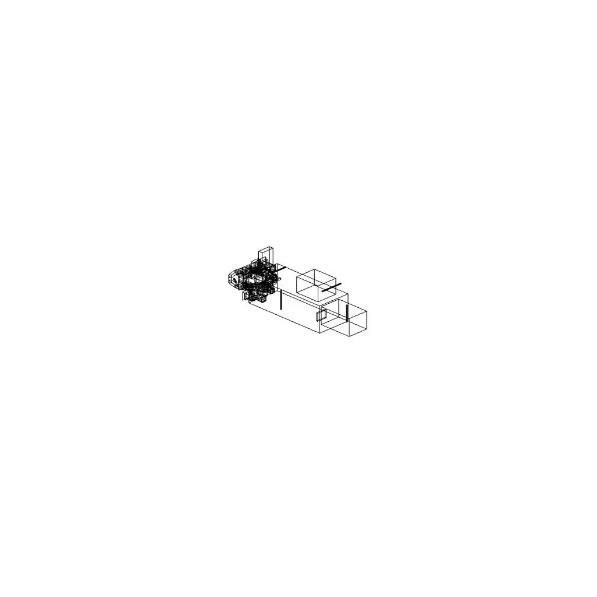

# Claude Code for Creatives

Interactive demos showcasing AI-assisted development for creative projects,
built collaboratively with [Claude Code](https://docs.anthropic.com/en/docs/claude-code).

**[View Live Demo](https://sultanpeyek.github.io/dagodao-claude-code-for-creatives-demo/)**

## Presentation

[](https://sultanpeyek.github.io/dagodao-claude-code-for-creatives)
[](https://github.com/sultanpeyek/dagodao-claude-code-for-creatives)

These demos accompany the **Claude Code for Creatives** presentation at the DagoDAO peer sharing session.

## Demos

### Image Swiper

Tinder-style photo organizer with gesture-based image review.

```bash
cd demo-1-final && bun install && bun start
```

### Void Vessels

Procedural NFT ship generator creating unique wireframe spacecraft from numeric seeds.

<p align="center">
  
</p>

```bash
cd demo-2-final && bun install && bun dev
```

See [demo-2-final/docs/COMMANDS.md](demo-2-final/docs/COMMANDS.md) for batch rendering.

## License

MIT

## Author

Built with Claude Code by [sultanpeyek](https://github.com/sultanpeyek)
